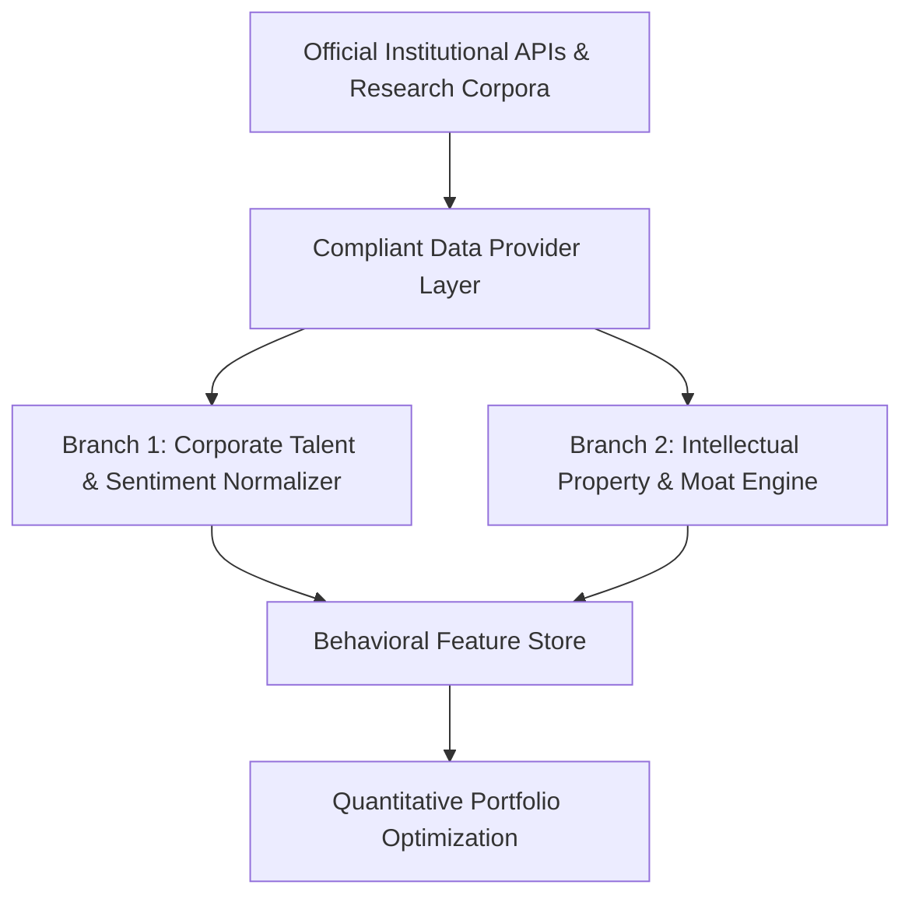

# Qualitative Blueprint: Master Strategy & Architectural Roadmap

This document serves as the master architectural reference for the Qualitative and Alternative Data components of the quantitative workspace. It outlines the strategy, financial and mathematical scoring calculations, component interfaces, and standardized data ingestion frameworks.

---

## 1. Executive Strategy & Ethical Framework

The Qualitative and Alternative Data subsystem manages the ingestion, cleaning, normalization, and scoring of alternative, unstructured, and corporate-momentum data sources. It translates qualitative signals into clean, standardized inputs for downstream quantitative modeling and portfolio optimization.

### Institutional & White-Hat Data Architecture

In alignment with academic research ethics and institutional standards, the system relies strictly on authorized institutional feeds, official public REST APIs, and pre-compiled research corpora:

- **SEC EDGAR API:** Official U.S. government REST API for point-in-time financial filings and XBRL disclosures, strictly adhering to SEC fair-access policies (declared User-Agent header and ≤ 10 req/sec rate limiting).
- **FRED API (Federal Reserve Bank of St. Louis):** Official macroeconomic time series and historical vintages.
- **USPTO PatentsView API:** Official U.S. Patent and Trademark Office data platform for tracking corporate innovation velocity and intellectual property moats.
- **Wikimedia Foundation REST API:** Authorized public knowledge graph endpoints under Creative Commons (CC BY-SA).
- **openFDA & ClinicalTrials.gov APIs:** Official government datasets for life sciences and regulatory tracking.

The platform utilizes an abstracted `AlternativeDataProvider` interface designed to consume pre-compiled academic research corpora and authorized vendor feeds, strictly avoiding brittle or non-compliant web scraping.



1. **Branch 1: Corporate Talent & Sentiment Normalizer**
   - Ingests structured, pre-compiled sentiment records and normalized surveys.
   - Evaluates talent retention, organizational trajectory, and governance risk metrics.
2. **Branch 2: Intellectual Property & Moat Engine**
   - Resolves corporate registry anchors (such as CIK identifiers and official entity IDs).
   - Maps developer momentum, patent portfolio growth, and public disclosures into namespace-guarded corporate moats.

---

## 2. Core Financial & Mathematical Calculations

All qualitative signals undergo strict mathematical standardizations and cash-flow adjustments before ingestion:

### A. Cold-Start EMA Filter
To prevent statistical instability with new or sparse data, the pipeline uses an expanding-mean smoothing method when the number of observations $N < 5$. Once $N \ge 5$, it transitions to an exponential moving average (EMA) with a decay factor $\alpha$ determined by the configurable half-life:
$$\alpha = 1 - e^{-\frac{\ln(2)}{\text{halflife}}}$$

### B. Two-Stage Double Standardizer
1. **Stage 1 (Time-Series):** Computes expanding time-series z-scores:
   $$z = \frac{x - \mu}{\sigma}$$
   The resulting z-score is compressed via a hyperbolic tangent clamp:
   $$\text{clamped\_z} = \tanh\left(\frac{z}{2.0}\right)$$
2. **Stage 2 (Cross-Sectional):** Performs daily peer-group z-score normalization across assigned sub-sectors (`semiconductors`, `platform_software`, `hardware_oem`) to eliminate industry-specific bias.

### C. 3-Year R&D Amortization & Capitalization
Operating R&D expenses are capitalized into balance-sheet intangible assets. They are amortized using straight-line schedules matching sector-specific lives (5.0 years for semiconductors/hardware, 4.0 years for software) to reconstruct the true Net Operating Profit After Tax (NOPAT) and Free Cash Flow (FCF).

### D. Stock-Based Compensation (SBC) Drag Intensity
Calculates dilution risk and operational drag intensity:
$$\text{Drag} = \min\left(1.0, 10.0 \times \left(0.4 \times \frac{\text{SBC}}{\text{Shares} \times \text{Price}} + 0.6 \times \frac{\text{SBC}}{\text{Revenue}}\right)\right)$$

### E. Trajectory Corridor Engine
A piecewise multi-stage growth decay model that clamps signals within an asymmetric corridor between a floor ($0.15$) and a ceiling ($0.92$):
$$\text{Output} = f(\text{clamped\_z})$$

### F. Ecosystem Market-Share Displacement Ratio (DR) & Monte Carlo Parameters
To capture real-time competitive shifts before they result in permanent failures, the engine cross-examines companies within the same sub-sector (e.g., comparing NVDA vs. AMD inside the semiconductors group).

The rolling 2-year developer engagement slope $\Delta$ is calculated from public repository metrics:
$$\Delta = \sum_{\text{repos}} \frac{\text{stars} + \text{forks} + \text{open\_issues}}{\max(0.1, \text{age\_in\_years})}$$
The relative displacement ratio $DR$ is calculated as:
$$DR = \frac{\max(0, \; \Delta_{\text{Competitor}})}{\max(0, \; \Delta_{\text{Leader}}) + 1e-6}$$
When $DR > 1.0$:
- **Tweak A (Front-Loaded Competitor Moat Penalty)**: Replaces the flat, uniform CAP distribution with a Right-Skewed Beta Distribution ($\alpha = 2, \beta = 5$) on compressed bounds (maxing at 5 or 6 years).
- **Tweak B (Sales-to-Capital Capital-Efficiency Drag/Boost)**: Scales down the mean of the Sales-to-Capital ($S/C$) ratio for the dominant firm (leader) by up to 30%, while scaling up the capital efficiency parameter for the challenger by up to 30%.

---

## 3. Package Structure & Responsibilities

The `Qualitative` directory is organized into modular packages:

```
Qualitative/
├── Qualitative Blueprint.md             # This master roadmap document
├── README.md                            # High-level overview
├── clustering/                          # Feature clustering & dimensionality reduction
├── normalization/                       # Cross-sectional and time-series standardizers
├── routing/                             # Sector driver routers
└── psychological/                       # Behavioral modeling & valuation translation
    ├── __init__.py                      # Package entry
    ├── interfaces.py                    # AlternativeDataProvider & feature vector schemas
    ├── qualitative_scoring.py           # EMA, Standardizers, R&D Capitalization
    ├── orchestrator.py                  # Master behavioral orchestrator
    ├── behavioral_feature_store.py      # Feature database interface
    ├── dcf_floor.py                     # DCF sentiment valuation floor
    ├── engineering_guards.py            # Lookahead and boundary checkers
    ├── velocity_tracker.py              # Normalized growth & posting velocity
    ├── signal_matrix.py                 # Assembles scoring matrices
    └── state_machine.py                 # Pipeline run state tracking
```
